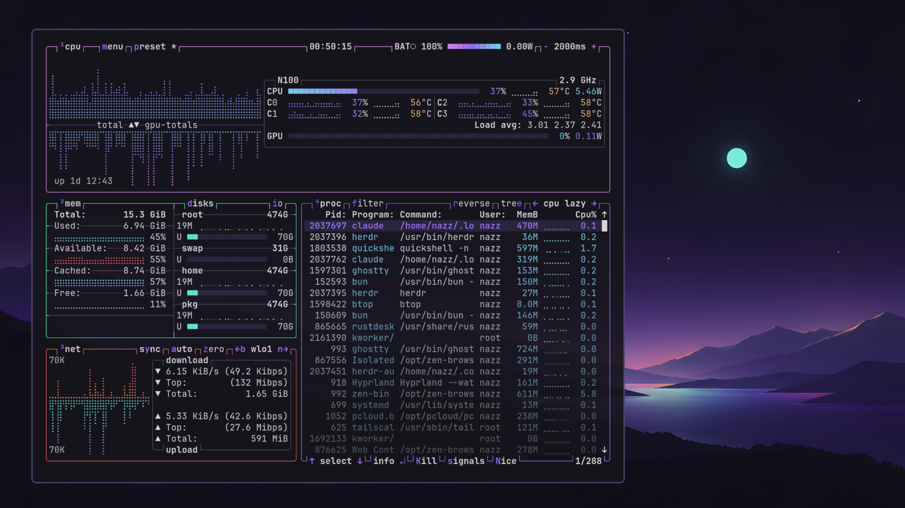

# Aura Dark for Omarchy

A faithful port of [Aura Dark](https://github.com/daltonmenezes/aura-theme) by Dalton Menezes to [Omarchy](https://omarchy.org). The colours come straight from the official palette in Aura's source (`src/core/colors/schemes/`), not from a lookalike.



## Install

```bash
omarchy theme install https://github.com/NazzarenoGiannelli/omarchy-aura-dark-theme
```

Or from the Omarchy menu: **Install → Style → Theme**, then paste the URL.

## What's in it

- **Palette**: Aura's signature violet `#a277ff` as the accent, with mint `#61ffca`, pink `#f694ff`, orange `#ffca85` and sky blue `#82e2ff` on the near-black `#15141b`. Aura's own terminal ports repeat several colours (blue, green and cyan are all mint); here every ANSI role gets a distinct colour, always from the official palette.
- **Softer window borders**: the focused window gets a muted violet (`#4d466e`) from the same palette instead of the full-saturation accent, which is loud around every window.
- **Six wallpapers**, 2560×1600:
  - `01`–`04`: night, aurora, geometry and fluid — original wallpapers made for this theme, generated with AI and upscaled with Real-ESRGAN;
  - `05`–`06`: two of the official Aura wallpapers.
- **Icons**: Yaru-purple.

## Optional: rounded corners, blur and transparency

The preview uses a few tweaks that a theme installed from a repo can't carry: Omarchy drops `.lua` files from those themes, because they could run code. If you want the same look, add this to `~/.config/hypr/looknfeel.lua`:

```lua
hl.config({
  decoration = {
    rounding = 6,
    blur = { enabled = true, size = 4, passes = 1 },
  },
})

-- Windows a little more transparent than Omarchy's default (0.985 / 0.96),
-- so the blurred wallpaper shows through. Apps Omarchy keeps opaque on purpose
-- (browsers, video, Steam, VMs) stay that way.
hl.window_rule({
  match = { tag = "default-opacity" },
  opacity = "0.90 0.87",
})
```

Note that `looknfeel.lua` applies to every theme, not just this one.

## Neovim and VS Code

These aren't set automatically, for the same reason. To match them by hand:

- **VS Code**: install [Aura Theme](https://marketplace.visualstudio.com/items?itemName=DaltonMenezes.aura-theme) and pick **Aura Dark**.
- **Neovim (LazyVim)**: add a plugin spec such as

  ```lua
  return {
    {
      "baliestri/aura-theme",
      lazy = false,
      priority = 1000,
      config = function(plugin)
        vim.opt.rtp:append(plugin.dir .. "/packages/neovim")
      end,
    },
    { "LazyVim/LazyVim", opts = { colorscheme = "aura-dark" } },
  }
  ```

## Credits

- **Aura** — colour palette and the official wallpapers `05` and `06`, © Dalton Menezes, MIT License. <https://github.com/daltonmenezes/aura-theme>
- **Omarchy port and wallpapers `01`–`04`** — Nazzareno Giannelli.

See [LICENSE](LICENSE).
